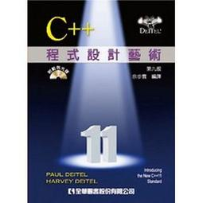

# myC-ProgramPractice
我的C++程式語言設計藝術練習

參考課本：C++程式設計藝術(余步雲 譯)
--------------------------

--------------------------
* [範例程式](sampleCode/README.md)：課本範例，依章節分在 `ch01`～`ch26` 與附錄 `appF`～`appJ`

* [我的練習紀錄檔](chapterDemo/README.md)：第 2～12、14 章的練習（Visual Studio 專案），以及「搞懂邏輯之Code」補充練習

* [簡易好懂指標教學](https://ithelp.ithome.com.tw/articles/10229956)